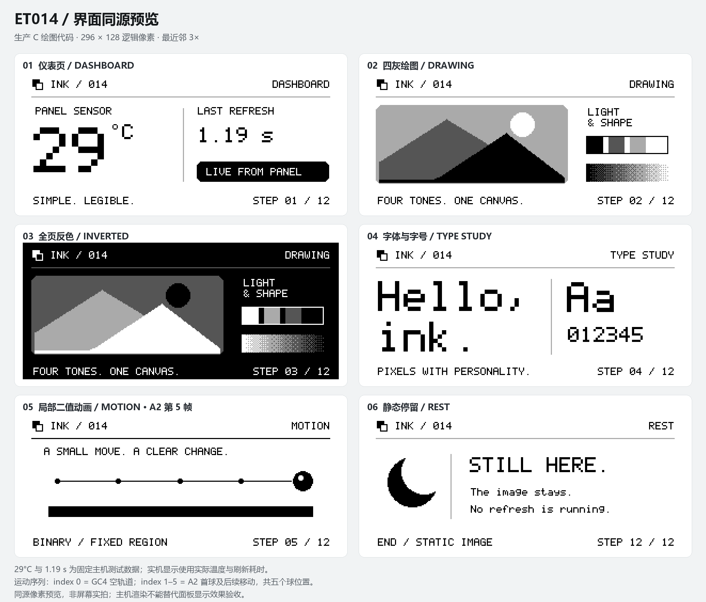

# ET014 E-paper Driver

**中文** | [English](README.en.md)

面向 **ET014TT1 / GDEP014TT1、128 × 296、四级灰度**墨水屏的 C 驱动库，提供可移植核心、绘图库、ESP32-S3 端口、串口控制台和 PC 传图工具。

我把屏幕驱动、绘图和平台接口拆开，方便在 ESP-IDF 项目中使用，也便于移植到其他 MCU。整页画面默认使用 GC4；示例保留有限的 A2 黑白小球动画，展示同一套绘图代码从主机预览到实机运行的路径。



图中画面是主机预览，不是实物照片。完整演示说明见 [Showcase](docs/SHOWCASE.md)。

## 能做什么

- 原生 128 × 296、2bpp 帧缓存，黑、深灰、浅灰、白四级；支持 296 × 128 横向绘图。
- 首次刷新或旧图状态失效时自动执行 INIT + GC4；正常更新使用 GC4，无变化时跳过刷新。
- 线、圆、矩形、填充、裁剪、反色、进度条和四方向旋转；内置可缩放 ASCII 点阵字体。
- 1bpp / 2bpp 图片，以及阈值、Bayer、Floyd–Steinberg 灰度转换。
- 专用 FreeRTOS 显示任务、帧间取消、异常关断和刷新统计。
- CRC32 校验的串口传图，以及一轮 12 步的有限演示。

UTF-8 解析和字形回调可用于外接中文字库，仓库没有内置中文字形。矩形更新只限制变化内容，仍扫描全部 296 行。

## 先准备

当前 ESP32-S3 端口针对 **ESP-IDF 5.5、240 MHz、SPI2 独占总线**实现，使用私有 SPI LL 接口。其他 SDK 版本和 MCU 需要适配并验证自己的 HAL。

原厂温区波形没有随仓库发布。请从你有权使用的 ET014TT1 / GDEP014TT1 原厂资料取得 `WaveformData.c`，在仓库根目录导入：

```sh
python tools/import_vendor_waveform.py "path/to/WaveformData.c"
```

导入后再构建和运行需要波形的测试；详见 [来源说明](SOURCES.md)。不要用其他型号屏幕的 LUT 替代。

### 默认接线

屏幕接口使用 3.3 V 供电，并与开发板共地。

| 屏幕信号 | ESP32-S3 GPIO |
| --- | --- |
| PWRON | 4 |
| RESETB | 5 |
| BUSY | 6 |
| OEI | 7 |
| CS | 10 |
| MOSI | 11 |
| SCK | 12 |
| MISO | 13 |

UART0 使用 GPIO43 / 44，也可以通过原生 USB Serial/JTAG 控制台操作。引脚可在端口配置中修改；这些 IO 和 SPI2 总线需由本示例独占。

默认参考 VCOM 为 **−2960 mV**，来自原厂主示例。本次实物样品没有标定标签；该参数没有经过模拟电压或功耗测量，使用其他样品前应核对它的资料。

## 编译与首次运行

先进入已配置 ESP-IDF 5.5 的终端，并完成波形导入：

```sh
cd examples/esp32s3
idf.py set-target esp32s3
idf.py build
```

烧录会写入连接设备的 Flash。执行前核对端口、开发板、分区表和已有数据；标准 `idf.py flash` 会写入构建生成的引导程序、分区表和应用，已有应用区更新应按自己的实际分区选择镜像与偏移。

```sh
idf.py -p <PORT> flash monitor
```

控制台使用 115200，命令以 LF 或 CRLF 结束。正常冷启动先等待 10 秒，再自动演示一轮，最后保留静态画面并关闭屏幕驱动电源。

```text
profile
probe
temp
city
refresh clean
```

`profile` 在 PWR 低、CS 高时检查扫描速度，`probe` 的预期 ID 为 `0x12`；`city` 只修改 RAM，`refresh clean` 才执行 INIT + GC4。若要首次上板时逐项检查，可在启动等待期发送 `showcase stop` 取消自动演示，再验证速度与 ID，最后刷新。

## 控制台与 PC 传图

| 命令 | 用途 |
| --- | --- |
| `showcase run` / `status` / `stop` | 重播、查看或停止有限演示 |
| `demo` / `fill 3` / `invert` | 在 RAM 中绘图、清白或反色 |
| `refresh auto` | 未知旧图时 INIT + GC4，已知旧图时 GC4 |
| `refresh gc4 0 0 64 64` | 更新原生坐标矩形内容 |
| `status` / `cancel` | 查询状态或请求帧间取消 |

`rotate 90` 改变后续绘图坐标，不旋转已有像素。刷新期间不能并发修改帧缓存。

以下 PC 工具命令在仓库根目录运行。打包只需 Python 标准库；串口操作安装 `pyserial`，PNG / JPEG 输入可选安装 `Pillow`。

```sh
python -m pip install pyserial Pillow
python tools/epdtool.py ports
python tools/epdtool.py command --port <PORT> "profile"
python tools/epdtool.py upload --port <PORT> assets/pixel-city-2bpp.bin --refresh clean
python tools/epdtool.py command --port <PORT> --timeout 150 "showcase run"
```

工具不自动选择端口或复位设备。传图采用固定 9472 字节 2bpp 帧和 CRC32；CRC 失败或传输超时不会提交画布。上传与刷新是两个独立动作，`--refresh` 明确指定后续刷新。

## 刷新模式与实测

GC4 是默认整页模式。连续整页换图时，GU4 曾出现清晰度下降和轻微残影，所以自动演示全部改用 GC4。GU4 / A2 仅在显式开启实验模式后可用；A2 要求旧图、新图均为黑白图。

| 项目 | 已验证范围 |
| --- | --- |
| GC4 四灰 | 当前样品可区分黑、深灰、浅灰、白，文字和图形清晰 |
| INIT + GC4 | 32 °C 下 121 + 31 帧，完整处理约 3.55 秒 |
| A2 有限动画 | 32 °C 下以 A2 建立并移动小球，起点残影对照得到实物确认 |
| v1.1.3 完整演示 | 29 °C 下 12 次更新、534 扫描帧、75.208 秒；GC4 × 7、A2 × 5、INIT × 2 |

上述结果对应本次屏幕样品与参考 VCOM。v1.1.3 的完整运行已完成，这一轮的最终画质与节奏仍待目视确认。主机测试覆盖 0–40 °C 波形预算，实物没有完成全温区、耐久、功耗或模拟电压测试。

演示只运行一轮；计划停留合计 58.5 秒，刷新和电源收尾另计。手动重播需等待 60 秒。小球动画最多 5 次 A2，结束后不继续刷新；这些数值是示例的操作量控制，不是面板寿命额定参数。

## 移植、测试与目录

实现 `et014_hal_t` 即可接入自己的平台。核心同步运行，示例通过唯一显示任务提供异步命令处理。新旧帧和扫描缓存共约 29 KB RAM，波形数据为 74472 字节，存放于 Flash；首次移植需验证行时序与扫描速度。

```text
components/et014/          C 核心、绘图库、温区接口
components/et014_esp32/    ESP32-S3 端口
components/et014_showcase/ 同源界面与 12 步计划
examples/esp32s3/         控制台与显示任务
tools/epdtool.py          图片处理、传图和命令
tests/                    假 HAL、波形核对、绘图与 PC 工具测试
docs/SHOWCASE.md          演示步骤与预览
```

导入原厂波形后，在有 C 编译器和 Python 的环境执行：

```sh
python tests/run-host-tests.py
python tests/test_hosttool.py
```

主机测试检查实际驱动数据、故障收尾、绘图和计划，不访问设备，也不测量残影、驱动电压或寿命。设备重新启动后不会猜测旧画面；错误或取消也会使旧图状态失效，下一次刷新重新初始化。

## 来源与许可

本仓库中由本项目创作并发布的源码、示例、测试、文档和演示素材采用 [MIT 许可证](LICENSE)。原厂波形数据、原厂资料及设备备份不包含在仓库内，其权利仍属于各自原权利人。详见 [SOURCES.md](SOURCES.md)。

版本变化见 [CHANGELOG.md](CHANGELOG.md)。反馈请附屏幕完整型号、SDK 版本、刷新模式、温度和可复现步骤。
