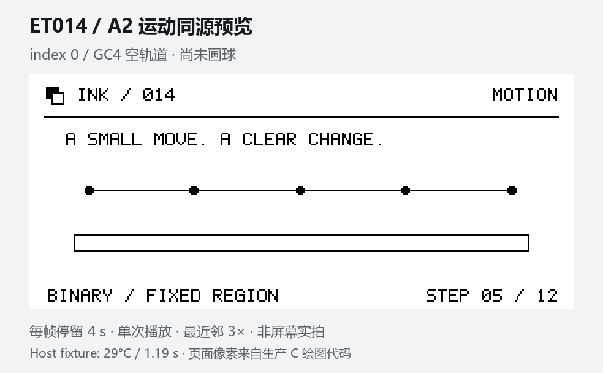

# ET014 墨水屏演示 / Showcase

[中文 README](../README.md) · [English README](../README.en.md)

一轮演示包含 5 个页面、12 次更新：温度与刷新耗时、几何绘图、四灰与抖动、反色、字号、有限二值动画，以及停止刷新后的静态保留。原生画布为 128 × 296，横向布局为 296 × 128，没有触摸输入。



PNG / GIF 由同一份生产 C 绘图代码生成，温度和耗时为主机测试数据，不是设备照片或实物拍摄。

## 12 步计划

停留时间从当前刷新完成后计算。

| 步骤 | 内容 | 模式 | 停留 |
| --- | --- | --- | --- |
| 1 | 温度仪表与最近刷新耗时 | INIT + GC4 | 8 秒 |
| 2 | 几何图形、四灰块、Bayer 渐变 | GC4 | 8 秒 |
| 3 | 整页反色 | GC4 | 7 秒 |
| 4 | 点阵字体与字号 | GC4 | 8 秒 |
| 5 | 空轨道背景 | GC4 | 4 秒 |
| 6–10 | A2 建立首球，再移动四次 | A2 | 每步 3.5 秒 |
| 11 | 重新读取温度与刷新耗时 | GC4 | 6 秒 |
| 12 | 静态结束画面 | INIT + GC4 | 结束 |

共 GC4 × 7、A2 × 5、GU4 × 0；首尾 GC4 各含一次 INIT，仍是 12 次页面更新。计划停留合计 58.5 秒。

v1.1.3 在本次实物样品的 29 °C 温度档完成整轮，实测 75.208 秒、534 扫描帧。这一轮的最终画质与节奏仍待目视确认。先前 32 °C 动画对照已确认 A2 建立与移动的小球起点没有残影；它仅覆盖当次有限序列。

## 操作与参数

正常冷启动等待 10 秒后自动运行一次。结束后关闭面板驱动电源，ESP32 仍可接收命令。异常复位抑制自动重播；手动重播有 60 秒冷却。

```text
showcase run
showcase status
showcase stop
```

停止会在允许的边界退出并执行关断，不额外强刷，中途可能留下未完成画面。下一轮完整演示从清刷开始。

温度取自屏幕传感器，在第 1、4、11 步采样，并在各段固定对应波形；它没有经过环境温度校准。当前波形使用范围为 0–40 °C，采样越界即停止。`LAST REFRESH` 显示上一项刷新记录，静态停留期间不持续更新遥测。

A2 只改原生坐标 `x=20, y=20, width=66, height=256` 的区域；新旧画面必须为黑白图，区域外保持不变。底层仍扫描全部 296 行。

有限步数、停留、首尾清刷和重播冷却用于限制示例操作量，不是厂家最小安全间隔或寿命额定值。没有完成耐久、全温区光学、功耗或模拟电压测量。

## English

The showcase has five pages and twelve updates: panel temperature and previous refresh duration, shapes, four-level grayscale and dithering, inversion, font sizes, a finite binary animation, and a retained final page. The native canvas is 128 × 296 and the landscape layout is 296 × 128. There is no touch input.

The preview above is generated by the production C renderer, using fixture values for temperature and timing. It is not a device recording.

The table lists the complete sequence. Dwell starts after each update finishes: dashboard 8 s, graphics 8 s, inversion 7 s, type 8 s, empty track 4 s, five A2 steps of 3.5 s, dashboard 6 s, and a final retained page. This totals 58.5 s of dwell, seven GC4 updates, five A2 updates, and no GU4 updates. The first and last GC4 operations each include INIT.

The complete v1.1.3 run on the tested sample at 29 °C took 75.208 s and 534 scan frames. Final visual acceptance of that run's clarity and pacing is pending. An earlier finite 32 °C comparison visually confirmed the initial ball position cleared when the ball was both created and moved with A2.

A normal cold boot waits 10 s, plays once, and shuts down panel drive power while the ESP32 console stays available. Abnormal resets suppress automatic replay. Manual replay uses a 60 s cooldown. The three commands above start, inspect, or stop the sequence. Cancellation finishes at an allowed boundary and powers down without an additional cleanup refresh; the image may be incomplete.

The panel sensor is sampled at steps 1, 4, and 11, with a fixed waveform selection within each segment. It is not a calibrated ambient thermometer. Out-of-range readings stop the demo; the current waveform range is 0–40 °C. `LAST REFRESH` refers to the preceding refresh, and telemetry does not update during static dwell.

A2 changes the native rectangle `x=20, y=20, width=66, height=256`. Both images must be binary and pixels outside the rectangle remain unchanged. All 296 rows are still scanned. Finite updates, dwell, cleanup, and cooldown limit demo activity; they do not establish endurance ratings or minimum safe intervals. Hardware endurance, full-temperature optical performance, power consumption, and analog drive voltage have not been measured.
